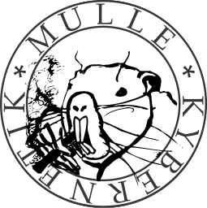

# 🛸 MulleUICore

#### 🛸 MulleUICore provides event handling and window management



See live on stream how it progresses: [https://www.twitch.tv/mulle_kybernetik_tv/](). Every Wednesday at 14:00-18:00 CEST.


### You are here

There is no actual "drawing" code in MulleUICore. Use "MulleGraphics" for drawing. See "MulleUIViews" for
widgets.

```
  .-----------------------------------------.
  | MulleUIFoundation                       |
  '-----------------------------------------'
  .-----------------------------------------.
  | MulleUIViews                            |
  '-----------------------------------------'
  .-----------------. .=====================.
  | MulleUIImage    | | MulleUICore         |
  '-----------------' '==============.======.
  .--------------------------------. | glfw |
  | MulleGraphics                  | | X11  |
  '--------------------------------' '------'
  .-----------------. .------------.
  | MulleCG         | | MulleCA    |
  '-----------------' '------------'
  .--------------------------------.
  | MulleLayout                    |
  '--------------------------------'
```

MulleUICore is only based on [MulleObjCLockFoundation](//github.com/MulleFoundation/MulleObjCFoundation). Foundation datatypes like `NSString` are not available.
