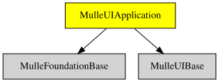

# MulleUIApplication

#### 𝄢 MulleUIApplication provides abstract classes like UIApplication and UIEvent


# 𝄢 MulleUIApplication

#### 𝄢 MulleUIApplication provides abstract classes like UIApplication and UIEvent

This library lays the ground work for window and event handling. It isn't tied
to any platform or graphics library. UIWindow is a protocol, that will get
fleshed out by MulleUIWindow (and MulleSDLWindow).


| Release Version                                       | Release Notes
|-------------------------------------------------------|--------------
|  [](//github.com/MulleUI/MulleUIApplication/actions) | [RELEASENOTES](RELEASENOTES.md) |


|Enum | Description
|-----|---------------------------------------
|`UIWindowStyleNop` |  No window style options set. Default empty value.
|`UIWindowStyleResizable` |  Allows the user to resize the window by dragging edges/corners.
|`UIWindowStyleInvisible` |  Renders offscreen, window is not shown on desktop. For offscreen rendering.
|`UIWindowStyleOffscreen` |  Renders offscreen with no associated visible desktop window. For pure offscreen use.
|`UIWindowStyleSingleBuffer` |  Uses single buffering instead of double buffering, no front/back buffer swap.
|`UIWindowStyleTransparent` |   Renders with a transparent background instead of opaque.
|`UIWindowStyleFloating` |   Window floats above other windows, not constrained by stacking order.
|`UIWindowStyleBare` | No window decorations like borders, title bar, close buttons etc are drawn.
|`UIWindowStyleEdgeAntialias` | Enables antialiasing on edge pixels for smoother edges.
|`UIWindowStyleStencilStrokes` |   Enables stencil buffer usage for stroke shapes without fill.
|`UIWindowStyleRetained` |   Retains rendered contents between frames for resize performance. Implies a separate thread.FZ
|`UIWindowStyleRetainedOnMainThread` |   Retained rendering occurs on main thread instead of separate thread.
|`UIWindowOpenGLCoreProfile` |  Requests OpenGL Core profile context instead of Compatibility.
|`UIWindowOpenGLForward` |   Requests forward-compatible OpenGL context for future compatibility.
|`UIWindowOpenGLLibraryFallback` | Fallback to system OpenGL library if custom OpenGL fails.
|`UIWindowOpenGLDeprecated` |   Includes deprecated OpenGL features in context.

### UIWindowStyleAntiAlias

The UIWindowStyleAntiAlias flag in MulleUI controls whether anti-aliasing is enabled for a window. It can be implemented in two ways:

Using multi-sample anti-aliasing (MSAA) if supported by the graphics backend. This provides full-scene anti-aliasing by sampling all pixels multiple times.

Falling back to UIWindowStyleEdgeAntialias if MSAA is not available. This enables basic anti-aliasing along polygon edges only.

Here is how it works:

By default UIWindowStyleAntiAlias is enabled in the window's styleMask.

During window creation, MulleUI checks if MSAA is supported by the graphics backend (like OpenGL).

If yes, MSAA will be enabled with a default sample count (e.g. 4x). This provides full-scene anti-aliasing.

If MSAA is not supported, MulleUI will automatically fall back to enabling UIWindowStyleEdgeAntialias instead.

So UIWindowStyleAntiAlias provides a simple way to get the best available anti-aliasing - either MSAA if possible, or edge anti-aliasing if not.

Disabling UIWindowStyleAntiAlias turns off both MSAA and edge anti-aliasing.

So in summary, UIWindowStyleAntiAlias handles enabling the best anti-aliasing method available in a seamless way. Developers don't have to worry about the details of checking for MSAA support etc.

### UIWindowStyleStencilStrokes

The UIWindowStyleStencilStrokes flag is used to enable stencil strokes rendering when drawing with MulleCG/nanovg.

Normally, shapes are drawn by filling or stroking them directly. But with stencil strokes, the shape is first drawn to a stencil buffer using the stroke outline. This stencil buffer is then used to mask the actual fill/stroke drawing.

This allows the stroke to always appear outside the fill, even when the shapes overlap or self-intersect. Without stencil strokes, overlapping filled shapes can cause the stroke to get hidden by the fill.

Enabling stencil strokes ensures the strokes will be properly drawn over the fills, avoiding stroke artifacts. But it comes at a performance cost since it requires an extra pass to draw the stroke to the stencil first.

So UIWindowStyleStencilStrokes trades off some performance for higher visual quality when stroking and filling complex overlapping shapes. It's useful for applications where stroke quality is really important.


### UIWindowStyleRetained

The UIWindowStyleRetained flag enables retaining the fully rendered framebuffer between frames to optimize performance.

It works by rendering into a back buffer while displaying the current framebuffer.

On each refresh, the retained back buffer is quickly copied to the foreground.

This avoids redundant redraw of static content each frame.

The entire framebuffer is retained and copied, not just updated areas.

It optimizes for rendering throughput over memory.

Retaining frames provides the fastest way to service refresh requests.

This enables smooth UI even with fully dynamic content.


///
No ARC, so memory management is manual with alloc/release

No UIScreen, windows are standalone

Focus on the listed Mulle repositories instead of Apple's UIKit

 in MulleUI the use of alloc/init/autorelease is discouraged. You either use -object for that or a convenience constructor like windowWithFrame:

Capture and return the status code from [app run]

The enclosing autoreleasepool set up by the MulleObjC runtime will handle proper memory management.

The /summary command should print out a summary of key points and learnings from our conversation so far, to help establish context and avoid repeating steps in future chats.

he retained buffer is there to quickly service refresh requests by X11. X11 proactively invalidates window contents and the refresh has to be asap so as not to create ugly black borders on resize for example


### You are here




## Add

Use [mulle-sde](//github.com/mulle-sde) to add MulleUIApplication to your project:

``` sh
mulle-sde add github:MulleUI/MulleUIApplication
```

To only add the sources of MulleUIApplication with dependency
sources use [clib](https://github.com/clibs/clib):


``` sh
clib install --out src/MulleUI MulleUI/MulleUIApplication
```

Add `-isystem src/MulleUI` to your `CFLAGS` and compile all the sources that were downloaded with your project.


## Install

### Install with mulle-sde

Use [mulle-sde](//github.com/mulle-sde) to build and install MulleUIApplication and all dependencies:

``` sh
mulle-sde install --prefix /usr/local \
   https://github.com/MulleUI/MulleUIApplication/archive/latest.tar.gz
```

### Manual Installation

Install the requirements:

| Requirements                                 | Description
|----------------------------------------------|-----------------------
| [MulleFoundationBase](https://github.com/MulleFoundation/MulleFoundationBase)             | 🧱 MulleFoundationBase amalgamates Foundations projects
| [MulleUIBase](https://github.com/MulleUI/MulleUIBase)             | 💺 MulleUIBase adds Objective-C to mulle-geometry and friends
| [mulle-objc-list](https://github.com/mulle-objc/mulle-objc-list)             | 📒 Lists mulle-objc runtime information contained in executables.

Download the latest [tar](https://github.com/MulleUI/MulleUIApplication/archive/refs/tags/latest.tar.gz) or [zip](https://github.com/MulleUI/MulleUIApplication/archive/refs/tags/latest.zip) archive and unpack it.

Install **MulleUIApplication** into `/usr/local` with [cmake](https://cmake.org):

``` sh
cmake -B build \
      -DCMAKE_INSTALL_PREFIX=/usr/local \
      -DCMAKE_PREFIX_PATH=/usr/local \
      -DCMAKE_BUILD_TYPE=Release &&
cmake --build build --config Release &&
cmake --install build --config Release
```


## Author

[Nat!](https://mulle-kybernetik.com/weblog) for Mulle kybernetiK  


