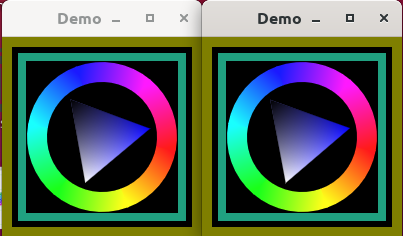

# demo


### two-windows

This demo runs two windows single-threaded with the help of UIApplication.
As the windows run by default with VSYNC enabled, you can see that one window
animation speeds up when the other window closes. That's because both windows
are waiting for VSYNC to redraw, so each window only gets half the framerate.

Call `two-windows vsync` or `two-windows softsync` to see the difference.



[main-two-windows.m](src/main-two-windows.m)


## mulle-sde

This is a [mulle-sde](//github.com/mulle-sde) project. mulle-sde combines
recursive package management with cross-platform builds via **cmake**:

Action  | Command                               | Description
--------|---------------------------------------|---------------
Build   | `mulle-sde craft [--release|--debug]` | Builds into local `kitchen` folder
Install | `mulle-sde install --prefix /usr/local https://github.com/<|GITHUB_USER|>/demo.git` | Like `make install`


### Manual Installation


Install the requirements:

Requirements                                      | Description
--------------------------------------------------|-----------------------
[some-requirement](//github.com/some/requirement) | Some requirement

Install into `/usr/local`:

``` sh
cmake -B build \
      -DCMAKE_INSTALL_PREFIX=/usr/local \
      -DCMAKE_PREFIX_PATH=/usr/local \
      -DCMAKE_BUILD_TYPE=Release &&
cmake --build build --config Release &&
cmake --install build --config Release
```


<!--
extension : mulle-sde/sde
directory : demo/all
template  : .../README.md
Suppress this comment with `export MULLE_SDE_GENERATE_FILE_COMMENTS=NO`
-->
